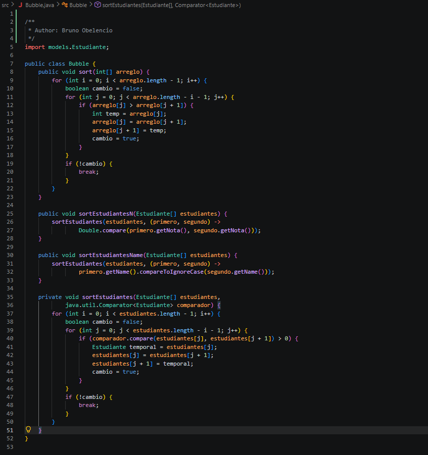
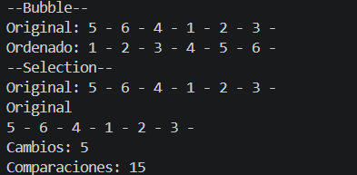

**Autor:** Bruno Isaac Obelencio Merchán 
**Evidencia de ordenamiento con Bubble sort:**

### 1. Captura del código

### 2. Explicación

El algoritmo Bubble Sort recorre el arreglo comparando los elementos de dos en dos. Si el de la izquierda es mayor que el de la derecha, los intercambia usando una variable auxiliar. Este ciclo se repite un montón de veces hasta que los números más grandes "flotan" hacia el final del arreglo. Honestamente, es un método bastante ineficiente; si tienes un arreglo con muchos datos, su rendimiento cae en picada porque se la pasa haciendo repasos y comparaciones innecesarias una y otra vez, pero al menos sirve para entender la lógica básica de cómo ordenar cosas.

### 3. Captura de la consola

