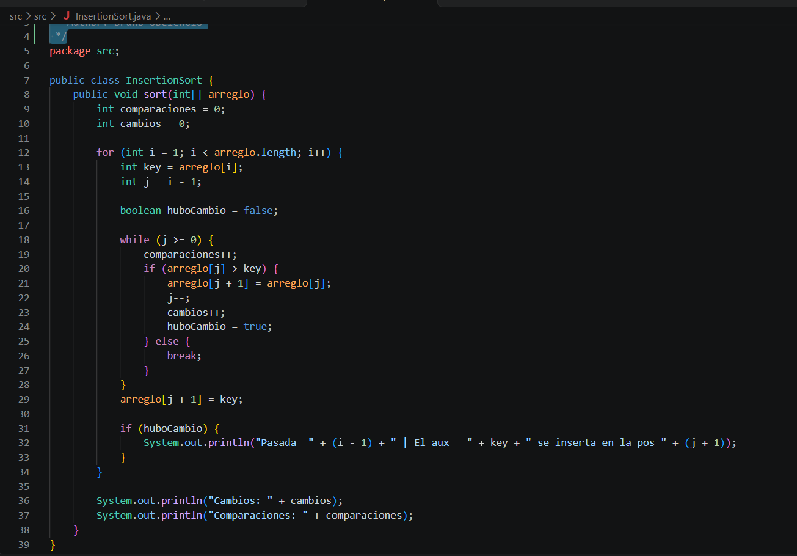
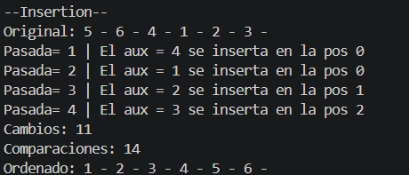

**Autor:** Bruno Isaac Obelencio Merchán **Evidencia de ordenamiento con Insertion sort:**

### 1. Captura del código

### 2. Explicación

Básicamente, el Insertion Sort es como cuando ordenas cartas en tu mano. El algoritmo coge un elemento de la parte que falta por revisar, lo compara con los de la izquierda y empuja los números mayores hacia la derecha para hacerle espacio. Ahí inserta el valor y repite este ciclo hasta dejar todo el arreglo ordenado de menor a mayor.

### 3. Captura de la consola

